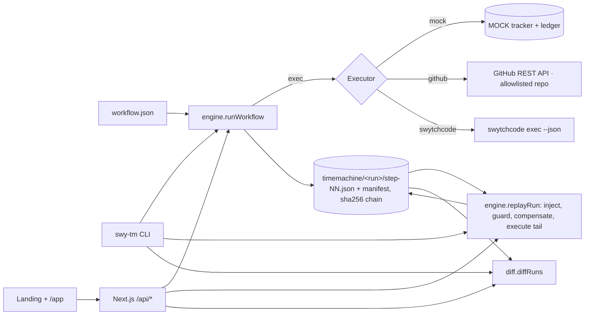

# swy-tm — Swytchcode Time Machine

> Independent prototype built for an onboarding assignment. Not affiliated with or endorsed by Swytchcode. MIT licensed.

A workflow-aware time-travel debugger on top of the [Swytchcode](https://docs.swytchcode.com) CLI: it records a snapshot after every step of a multi-step workflow, lets you inspect any step, **replays from step N with modified inputs while injecting the recorded outputs of earlier steps (they are not re-executed)**, guards side-effecting steps, and prints a divergence report. A web UI (`/` landing page, `/app` debugger) runs the same engine against the real GitHub API.

## Debug real GitHub workflows, one account at a time

Open `/app`, paste **your own** GitHub token and a repository (`owner/name`) and press **Connect**. From then on every run is a real GitHub run:

1. **Run on GitHub** — the workflow creates an issue, labels it, (optionally) comments, then sets its state. Each step is recorded as a hash-chained snapshot.
2. **Break it on purpose** (or hit a real error) — the failing step shows GitHub's actual response and a suggested fix.
3. **Fix and replay from that step** — earlier steps are *injected from the recording*, not re-executed, so no duplicate issue is created. The run header shows `GitHub calls` vs `steps reused`.
4. **Undo and re-run** — *compensate* closes the issue, removes the label and deletes the comment (in reverse order) before re-running from an earlier step. The side-effect guard refuses to repeat real effects unless you choose compensate or allow-duplicate.
5. **Live check** — asks GitHub what really exists and compares it with what the snapshots recorded (`IN SYNC` / `DRIFT` / `MISSING`), so you notice if someone edited the issue by hand.
6. **Verify chain** — recomputes every hash; any edit to a stored snapshot is rejected.

Privacy model: the token is held only in your browser (session storage, or local storage if you tick *Remember*) and sent as a header with each API call. The server verifies it against GitHub, uses it for that request, and never stores or logs it. Runs are saved in PostgreSQL under `gh:<your GitHub user id>`; other accounts cannot list, read, replay or diff them. Without a database, your runs stay in your browser and are sent back (hash-verified) when you replay. The executor only ever acts on the repository you connected.

Recommended token: a fine-grained personal access token limited to one repository with **Issues: Read and write**. Revoke it any time at github.com/settings/tokens.

Before connecting, `/app` shows a clearly labelled, read-only *example recording* so you can see what a run looks like.

### API
| Route | Purpose |
|---|---|
| `POST /api/github/connect` | Verify token + repository against GitHub (headers `x-gh-token`, `x-gh-repo`) |
| `POST /api/runs` | Run `github-issue` or `github-triage` for real (`dryRun: true` only plans) |
| `GET /api/runs`, `GET /api/runs/:id` | Your saved history |
| `POST /api/runs/:id/replay` | Replay from a step with overrides, `compensate`, `allowDuplicate` |
| `POST /api/runs/:id/reconcile` | Live check against GitHub |
| `POST /api/runs/:id/verify`, `GET /api/diff`, `GET /api/ledger` | Integrity, divergence, side-effect ledger |

Optional server-owned mode (a single trusted owner, behind Neon Auth) still works when `GITHUB_TOKEN`, `GITHUB_OWNER`, `GITHUB_REPO`, `GITHUB_ALLOWED_EMAIL`, `NEON_AUTH_BASE_URL` and `NEON_AUTH_COOKIE_SECRET` are set; it is not required for visitors.

Local setup: set `DATABASE_URL` (and `DATABASE_URL_UNPOOLED` for migrations if pooled), run `npm run db:push`, then `npm run dev`. The offline simulator used by the CLI demo and the test-suite never appears in the web debugger.

## Problem and intended user
When step 3 of a 3-step agent workflow fails, steps 1–2 already created real side effects. Re-running everything risks duplicates; audit logs say *that* it failed, not what state step 2 left behind, and you cannot change one input and re-run only the tail. Intended user: someone building agent workflows on Swytchcode methods.

## API / integration explored
Swytchcode CLI 2.25.1 (`init`, `get`, `add method`, `info`, `list`, `search`, `exec`, `audit`, `demo`) and the GitHub provider's Wrekenfile (`github.issue.create`, `github.issue.labels.create`, `github.issue.update`). Every command and its real output: [docs/verified-facts.md](docs/verified-facts.md).

## Setup and commands
Requires Node ≥ 22. Available checks include `npm run lint`, `npm run typecheck`, `npm run build`, `npx vitest run`, and `npx playwright test`.
```bash
npm install
./bin/swy-tm demo                       # or: npx tsx src/cli/index.ts demo   (MOCK executor, offline)
npx vitest run                          # engine, API and real-GitHub flow tests (fake GitHub server)
npm run build                           # Next.js production build
./scripts/restart-server.sh             # serves UI + API on http://127.0.0.1:4173 (UI at /app)
npx playwright test                     # e2e at 1440×900 and 390×844 (server must be running)
./scripts/verify.sh                     # everything above in order
```
CLI:
```bash
./bin/swy-tm run workflows/demo-tracker.workflow.json      # fails at step 2 (MOCK 422 invalid_state)
./bin/swy-tm list
./bin/swy-tm inspect <run> --step 1
./bin/swy-tm replay <run> --from-step 2 --set inputs.finalState=closed
./bin/swy-tm replay <run> --from-step 0 --set inputs.finalState=closed --compensate
./bin/swy-tm diff <runA> <runB>
./bin/swy-tm verify <run>
./bin/swy-tm serve --open
```
Exit codes: `replay` 0 ok · 1 replay failed · 2 bad override · 3 side-effect guard abort · 4 unusable earlier snapshot · 5 run not found.
Real executor (needs the `swytchcode` binary, run from the repo root where `.swytchcode/` lives):
`./bin/swy-tm run workflows/github-issue.workflow.json --executor swytchcode --dry-run --set inputs.owner=… --set inputs.repo=…`

## What worked
- Hash-chained per-step snapshots with redaction (`authorization/token/api_key/password/secret` → `[REDACTED]`), `verify` detects tampering.
- Replay from step 2 makes **1 executor call and injects 2 steps** (asserted in tests); the mock ledger shows `created: 1`, not 2.
- Side-effect guard (exit 3, nothing executed), `--compensate` (reverse order, then replay → ledger `created 2, deleted 1`).
- Divergence report with volatile-field counting; the same engine is served to the UI.
- The real Swytchcode executor runs `swytchcode exec --json` with `{"tool","args"}` on stdin and records the CLI's classified stderr error as a snapshot (verified with the GitHub dry-run).
- Web `/` with sections A–L and global systems, `/app` debugger with live replay over SSE, guard panel, ledger, static fallback.

## What did not work (exact errors in FRICTION.md)
- `swytchcode get github` → `error: authentication required for get: not authenticated - run \`swytchcode login\`…`. Workaround: `exec` auto-fetches the Wrekenfile.
- `swytchcode exec … --dry-run` → `missing credentials for GitHub - run \`swytchcode auth connect GitHub\``. Auth is interactive OAuth, so **no real GitHub issue was created**; the `github-issue` workflow is only a recorded dry-run that fails at step 0.
- REA reference study was skipped; Lighthouse was not run (see docs/ui-parity.md).

## How to reproduce
`npm install && ./bin/swy-tm demo` (spec's `npm run demo` is not available, see above). Sample output from a real demo run is committed in `examples/snapshots/` and `examples/transcripts/demo.json`; the website's hero, terminal player and static `/app` demo are built from those files.

## Demo video
TODO_ADD_VIDEO_URL

## Notes on the generated Wrekenfile
`.swytchcode/integrations/GitHub/github/1.1.4/wrekenfile.yaml` (3 MB, 1,204 methods) was fetched by `swytchcode exec`, not hand-written, and **nothing in it was changed**. Methods read: `github.issue.create` (POST `/repos/{owner}/{repo}/issues`; inputs `owner`, `repo` as path, `body`), `github.issue.labels.create` (POST …`/issues/{issue_number}/labels`), `github.issue.update` (PATCH …`/issues/{issue_number}`). Excerpt: `docs/wrekenfile-excerpt.yaml`. `tooling.json` lists exactly those three methods (added with `swytchcode add method`).

## Architecture


## Limitations
- Prototype; sequential workflows only (no parallel steps, no distributed runs).
- Does **not** read Swytchcode's internal state: Time Machine keeps its own snapshots, and the output of each step is the state carrier.
- Compensation is best-effort and user-defined; no rollback guarantee.
- Redaction is key-name based; secrets under other key names would be stored. Redacted values flow into injected context.
- SSE bus is in-memory (single process); run history is durable in Neon. `serve` uses the Next.js server bound to 127.0.0.1.
- Real GitHub execution works for any visitor who connects their own token. Automated tests drive the real code paths against an in-process fake of the GitHub REST API (no live issue is created by tests).
- Replay of `--executor swytchcode` re-resolves nothing from Swytchcode: injected outputs are the recorded ones.

## AI disclosure
Written end to end by an AI coding agent (this repository and its docs), including the Swytchcode CLI probing, code, tests and UI, from a build spec supplied by the user. Command outputs quoted in docs were produced by actually running the commands. REA was **not** used. The human still needs to review everything, record the demo video and submit the form.

Interaction design inspired by modern award-style agency sites.
