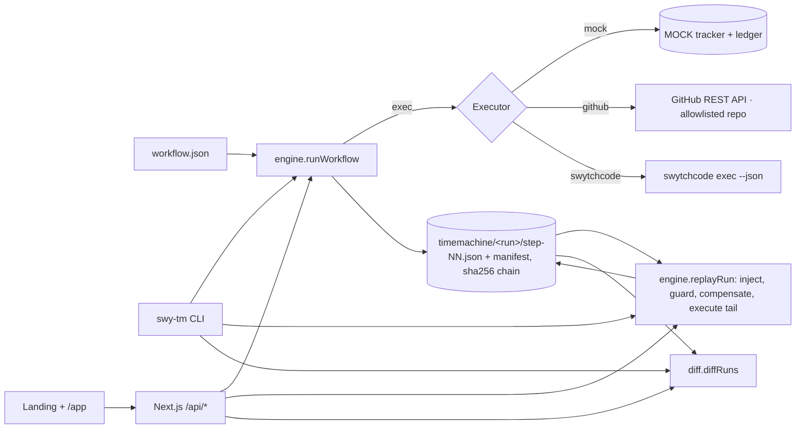

# swy-tm — Swytchcode Time Machine

> Independent prototype built for an onboarding assignment. Not affiliated with or endorsed by Swytchcode. MIT licensed.

A workflow-aware time-travel debugger on top of the [Swytchcode](https://docs.swytchcode.com) CLI: it records a snapshot after every step of a multi-step workflow, lets you inspect any step, **replays from step N with modified inputs while injecting the recorded outputs of earlier steps (they are not re-executed)**, guards side-effecting steps, and prints a divergence report. A local web UI (`/` landing page, `/app` debugger) reads the same snapshots.

## Live full-stack deployment

The deployed Next.js app uses Neon PostgreSQL for durable run manifests and snapshot history. API traffic uses the pooled `DATABASE_URL`; Drizzle schema management uses `DATABASE_URL_UNPOOLED`. Neon Auth is exposed through `/api/auth/*` when its Vercel environment variables are configured.

- Website: https://switchtm-eight.vercel.app/
- Health check: https://switchtm-eight.vercel.app/api/health
- Run API: `POST /api/runs`, `GET /api/runs`, `GET /api/runs/:id`
- Replay API: `POST /api/runs/:id/replay`

For local setup, copy the Neon variables into `.env.local`, then run `npm run db:push` followed by `npm run dev`. The debugger displays a live API banner even when the database has no runs yet; its bundled snapshots are only a preview until the first run is created.

## Enable real GitHub issue execution

The debugger has two distinct paths: **Run live GitHub workflow** calls the GitHub REST API; **Run mock demo** is an isolated simulator and never contacts GitHub. The live action creates an issue, adds the configured label, then sets its final state. Each completed step is recorded as a hash-chained snapshot and the run plus snapshots are saved to PostgreSQL before appearing in run history.

Configure these values as server-side environment variables in the deployment (for Vercel, in the project's Environment Variables settings; never commit them or paste a token into chat):

| Variable | Purpose |
|---|---|
| `GITHUB_TOKEN` | Fine-grained GitHub token with Issues read/write permission on only the target repository. |
| `GITHUB_OWNER` | Fixed owner/organization allowed for real calls. |
| `GITHUB_REPO` | Fixed repository allowed for real calls. |
| `GITHUB_ALLOWED_EMAIL` | Exact email permitted to sign in and execute/view live runs. |
| `NEON_AUTH_BASE_URL` | Neon Auth instance URL. |
| `NEON_AUTH_COOKIE_SECRET` | Random secret of at least 32 characters for the Neon Auth session cookie. |
| `DATABASE_URL` | Pooled PostgreSQL connection used for durable run/snapshot history. |

After setting the variables, redeploy the application. `/api/health` must report `github.ready: true` and `database: true`. Sign in at `/auth/sign-in` with the configured allowed email. Live execution and run/snapshot/diff/ledger APIs reject unauthenticated or other-account requests. The executor rejects any workflow owner/repo that does not exactly match the server allowlist. Without these settings the live action stays disabled; sample data remains labelled as preview, not as a completed real run.

## Using the debugger without signing in

The mock demo, replay, compensate and hash-chain verification work for everyone, with or without a database or login. The mock executor touches no real system, so it is never gated. Runs the server cannot look up itself (the bundled sample preview, serverless instances that share no history, signed-out visitors) are sent back with the request and verified against their hash chain before they are replayed, and only `mock` runs are accepted this way. Signed-in owners additionally get runs saved to history; live GitHub execution and private run history always stay behind sign-in.

## Problem and intended user
When step 3 of a 3-step agent workflow fails, steps 1–2 already created real side effects. Re-running everything risks duplicates; audit logs say *that* it failed, not what state step 2 left behind, and you cannot change one input and re-run only the tail. Intended user: someone building agent workflows on Swytchcode methods.

## API / integration explored
Swytchcode CLI 2.25.1 (`init`, `get`, `add method`, `info`, `list`, `search`, `exec`, `audit`, `demo`) and the GitHub provider's Wrekenfile (`github.issue.create`, `github.issue.labels.create`, `github.issue.update`). Every command and its real output: [docs/verified-facts.md](docs/verified-facts.md).

## Setup and commands
Requires Node ≥ 22. Available checks include `npm run lint`, `npm run typecheck`, `npm run build`, `npx vitest run`, and `npx playwright test`.
```bash
npm install
./bin/swy-tm demo                       # or: npx tsx src/cli/index.ts demo   (MOCK executor, offline)
npx vitest run                          # 15 engine + API tests
npm run build                           # Next.js production build
./scripts/restart-server.sh             # serves UI + API on http://127.0.0.1:4173 (UI at /app)
npx playwright test                     # e2e at 1440×900 and 390×844 (server must be running)
./scripts/verify.sh                     # everything above in order
```
CLI:
```bash
./bin/swy-tm run workflows/demo-tracker.workflow.json      # fails at step 2 (MOCK 422 invalid_state)
./bin/swy-tm list
./bin/swy-tm inspect <run> --step 1
./bin/swy-tm replay <run> --from-step 2 --set inputs.finalState=closed
./bin/swy-tm replay <run> --from-step 0 --set inputs.finalState=closed --compensate
./bin/swy-tm diff <runA> <runB>
./bin/swy-tm verify <run>
./bin/swy-tm serve --open
```
Exit codes: `replay` 0 ok · 1 replay failed · 2 bad override · 3 side-effect guard abort · 4 unusable earlier snapshot · 5 run not found.
Real executor (needs the `swytchcode` binary, run from the repo root where `.swytchcode/` lives):
`./bin/swy-tm run workflows/github-issue.workflow.json --executor swytchcode --dry-run --set inputs.owner=… --set inputs.repo=…`

## What worked
- Hash-chained per-step snapshots with redaction (`authorization/token/api_key/password/secret` → `[REDACTED]`), `verify` detects tampering.
- Replay from step 2 makes **1 executor call and injects 2 steps** (asserted in tests); the mock ledger shows `created: 1`, not 2.
- Side-effect guard (exit 3, nothing executed), `--compensate` (reverse order, then replay → ledger `created 2, deleted 1`).
- Divergence report with volatile-field counting; the same engine is served to the UI.
- The real Swytchcode executor runs `swytchcode exec --json` with `{"tool","args"}` on stdin and records the CLI's classified stderr error as a snapshot (verified with the GitHub dry-run).
- Web `/` with sections A–L and global systems, `/app` debugger with live replay over SSE, guard panel, ledger, static fallback.

## What did not work (exact errors in FRICTION.md)
- `swytchcode get github` → `error: authentication required for get: not authenticated - run \`swytchcode login\`…`. Workaround: `exec` auto-fetches the Wrekenfile.
- `swytchcode exec … --dry-run` → `missing credentials for GitHub - run \`swytchcode auth connect GitHub\``. Auth is interactive OAuth, so **no real GitHub issue was created**; the `github-issue` workflow is only a recorded dry-run that fails at step 0.
- REA reference study was skipped; Lighthouse was not run (see docs/ui-parity.md).

## How to reproduce
`npm install && ./bin/swy-tm demo` (spec's `npm run demo` is not available, see above). Sample output from a real demo run is committed in `examples/snapshots/` and `examples/transcripts/demo.json`; the website's hero, terminal player and static `/app` demo are built from those files.

## Demo video
TODO_ADD_VIDEO_URL

## Notes on the generated Wrekenfile
`.swytchcode/integrations/GitHub/github/1.1.4/wrekenfile.yaml` (3 MB, 1,204 methods) was fetched by `swytchcode exec`, not hand-written, and **nothing in it was changed**. Methods read: `github.issue.create` (POST `/repos/{owner}/{repo}/issues`; inputs `owner`, `repo` as path, `body`), `github.issue.labels.create` (POST …`/issues/{issue_number}/labels`), `github.issue.update` (PATCH …`/issues/{issue_number}`). Excerpt: `docs/wrekenfile-excerpt.yaml`. `tooling.json` lists exactly those three methods (added with `swytchcode add method`).

## Architecture


## Limitations
- Prototype; sequential workflows only (no parallel steps, no distributed runs).
- Does **not** read Swytchcode's internal state: Time Machine keeps its own snapshots, and the output of each step is the state carrier.
- Compensation is best-effort and user-defined; no rollback guarantee.
- Redaction is key-name based; secrets under other key names would be stored. Redacted values flow into injected context.
- SSE bus is in-memory (single process); run history is durable in Neon. `serve` uses the Next.js server bound to 127.0.0.1.
- Real GitHub execution is available when its token, allowlisted repository, Neon Auth session, and PostgreSQL environment are configured. No live issue is created by automated tests; the mock demo remains a separate simulator.
- Replay of `--executor swytchcode` re-resolves nothing from Swytchcode: injected outputs are the recorded ones.

## AI disclosure
Written end to end by an AI coding agent (this repository and its docs), including the Swytchcode CLI probing, code, tests and UI, from a build spec supplied by the user. Command outputs quoted in docs were produced by actually running the commands. REA was **not** used. The human still needs to review everything, record the demo video and submit the form.

Interaction design inspired by modern award-style agency sites.
